  

<h1 align="center">👾 Hey, I'm Abhinav</h1>

<h4 align="left">🛰️ Director of Operations @ <a href="https://osintnova.com">OSINTNova</a> 🛡️ Head of the CyberSentinel Club @ VelTech ⚖️ Chief of Projects Moderation @ <a href="https://www.firstdecree.org">The First Decree</a> 🔍 OSINT · Penetration Testing · Active Directory · Reverse Engineering 🛠️ Backend development & open-source security tooling</h4>

###

### 🔭 Projects
- 🔎 **[fieldsift](https://github.com/localhostdotexe/fieldsift)** – CLI that reverse-engineers unknown binary formats by comparing samples: finds length fields, offsets, checksums and chunk layout, and exports ImHex patterns

- 📧 **SentinelMail** – AI-powered email threat detection & forensics platform, Smart India Hackathon 2026 (team HopZero)
- 🧩 Opened [PR #1663](https://github.com/usestrix/strix/pull/1663) on [Strix](https://github.com/usestrix/strix) (open-source AI pentesting tool) to fix LLM connection failures with Mistral reasoning models
- 📝 **[Millennium write-up](https://github.com/localhostdotexe/millennium-writeup)** – Active Directory lab write-up (Hack Smarter, Medium)

### 🎓 Certifications

- 🏴 [Foundations of Ethical Hacking](https://www.hacksmarter.org/completion/19c0f8e6219d697c) · [Challenge Lab: Walnut](https://www.hacksmarter.org/completion/721dccf12a37c209) · [Challenge Lab: Kitsune](https://www.hacksmarter.org/completion/a0d118fa3a7f9946) · [Challenge Lab: Millennium (Medium, AD)](https://www.hacksmarter.org/completion/a08a30bd4f5d29ec) – [Hack Smarter Labs](https://www.hacksmarter.org/learners/a669e015-46b4-41f3-832b-cb2b4bc7de82)

###

  
  
  
  
  
  
  
  
  
  
  
  
  
  
  
  
  

###

<picture>
  <source media="(prefers-color-scheme: dark)" srcset="https://raw.githubusercontent.com/localhostdotexe/localhostdotexe/output/pacman-contribution-graph-dark.svg">
  <source media="(prefers-color-scheme: light)" srcset="https://raw.githubusercontent.com/localhostdotexe/localhostdotexe/output/pacman-contribution-graph.svg">
  
</picture>

###

###
